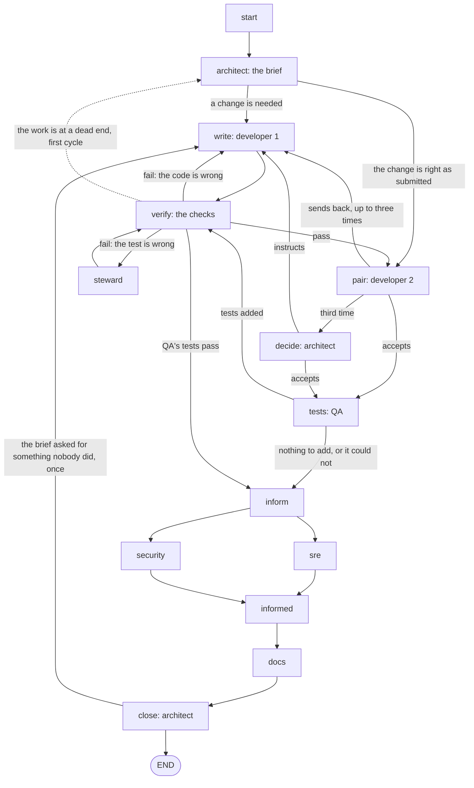
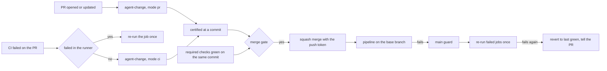

# ci-shared — Architecture

How the pieces of this repository fit together and why they are shaped the way they are.
The [README](../README.md) is the quick reference (inputs, wrapper examples, setup); this is the
explanation. A consumer's view of the same system is in
`flask-test-api/docs/13-agent-pipeline.md`.

## What this repository is

One place for the logic of an agentic CI loop, used by other repositories through thin caller
workflows. A consumer keeps only triggers and parameters; the workflows, the scripts and the prompts
live here. Model calls go through one stdlib-only client and any OpenAI-compatible chat-completions
endpoint; the model is whatever `OPENROUTER_MODEL` names.

The goal the design serves: **a change ends merged, abandoned or reverted, and none of the three waits
for a person.** Everything below follows from that, and from one rule: *if a command can prove
something, ask the command, not the model.*

## Repository layout

```
ci-shared/
├── .github/workflows/
│   ├── reusable_agent-change.yml      review, repair, certify a pull request or a push (the engine)
│   ├── reusable_agent-merge.yml       merge gate: certified and green on the same commit
│   ├── reusable_agent-main-guard.yml  base branch red after a merge: re-run once, then revert
│   ├── reusable_pipeline-health.yml   the loop checks itself (no model)
│   ├── reusable_pipeline-canary.yml   known changes through the real loop, outcome checked
│   ├── reusable_changelog.yml         deterministic changelog entry
│   ├── reusable_docs-architect.yml    documentation proposal, plan only
│   ├── reusable_agent-pipeline.yml    the engine started from a written request (planner first)
│   ├── reusable_agent-review.yml      the four reviewers only, one comment
│   ├── reusable_pr-diff-review.yml    single-reviewer comment on a diff
│   ├── agent-change.yml, agent-ci-failure.yml, agent-merge.yml   this repository under its own loop
│   ├── release-tag.yml                moves v3 after the tests and the consumer's canary pass
│   └── test.yml                       this repository's tests
├── prompts/
│   ├── agents/*.md                    one prompt per agent role
│   └── pr-review-system.md            base prompt of the single-reviewer path
├── scripts/
│   ├── agent_pipeline.py    the engine: a LangGraph state machine, and the commands around it
│   ├── agent_lib.py         parsing, patches, guards, evidence, isolated verification
│   ├── pr_review_sweep.py   what is left of the dependency sweep: helpers the engine uses
│   ├── pipeline_health.py   the health check
│   ├── pipeline_canary.py   the canary
│   ├── openrouter_ai.py     the model client
│   ├── ai_sanitize.py, ai_append_cost.py, render_prompt.py, changelog_update.py
│   └── requirements-autofix.txt   the one non-stdlib dependency (langgraph)
├── tests/                   no network, no real `gh` calls
└── docs/architecture.md     this file
```

## The engine

`scripts/agent_pipeline.py` builds one `StateGraph`. A change that already exists (a pull request, a
pull request whose checks failed, a push on the base branch: `reusable_agent-change.yml`) enters at the
architect and is closed by it. Not yet seen in a released run: the whole of this section is on the way
in, shown on three local replays of real pull requests.



| Node | Role | May change |
|---|---|---|
| `architect` | Runs the checks, then writes the brief every other role works from: what the developer must change, file by file; what the tests must check; whether infrastructure, security and documents are concerned; the facts it established. It reads first (role `architect-read`, no thinking, up to twelve look-ups) and thinks once, on the brief | Nothing |
| `write` | Developer 1, always the agent, also on a person's pull request. Reads (`writer-read`), then proposes a patch | Code and tests, through a validated patch |
| `verify` | Runs the consumer's verify command in a process with no secrets | Nothing (reverts a patch that fails) |
| `pair` | Developer 2 (`reviewer-correctness`): same model, other instructions, no shared context. It has the brief, the touched files whole, the diff and the record of the run. Accepts, or sends back | Nothing |
| `decide` | The third time the pair does not agree, the architect accepts the change or gives one last instruction, which is not reviewed again | Nothing |
| `tests` | QA (`test-steward`): which behaviours to check comes from the brief | Tests only |
| `steward` | QA updates tests a verdict found wrong | Tests only |
| `sre`, `security` | Two nodes started together. They read the diff and what the pipeline's tools reported for the commit and for the base commit (artifacts `ai-context-*`), and inform | Nothing |
| `docs` | Documentation reviewer, then a deterministic changelog entry | Documentation and changelog |
| `close` | The architect tells what happened, for a person who was not there, and names what its brief asked for and nobody did | Nothing |

What the code decides, not a prompt:

- **Whether the change works is a fact.** Every commit that reaches the close went through the checks.
  No finding and no opinion ends a change whose checks pass.
- **Facts oblige the roles** (`lib.roles_required`): application code touched calls QA; Dockerfile,
  chart, compose, workflows, configuration call the SRE; dependencies, authentication, secrets call
  security. The architect can add a role and say what to look at; it cannot take one away.
- **Who thinks** (`ModelCaller.THINKING`): the roles that write code or the brief (`writer`,
  `test-steward`, `architect`, `architect-decide`). Every other role, and every reading step, answers
  at once: seconds instead of minutes, measured.
- **The pair**: only developer 2 sends a change back, up to three times; then the architect decides. A
  critical or high finding goes back; so does, the first time the change is read and only then, a
  medium one of category `bug` (`worth_one_fix`).
- **QA never ends a change that works.** Tests it writes that do not pass, twice, are taken out; an
  answer that cannot be used is dropped. The change goes on with the tests it had, and the comment says
  so (the health check looks for that sentence). A test that existed and fails is another matter: it is
  the specification.
- **What the brief asked for and nobody did** goes back to the developer once, from the close. If it
  cannot be done, or breaks the checks, it is taken back and reported; the change is not undone.
- **A second cycle, once.** Work at a dead end (checks that keep failing, no usable brief) returns to
  the architect with the reason; a second dead end is the end: abandoned.
- **A model that is unavailable** raises `ModelUnavailable`; the node is tried again by the graph
  (`RetryPolicy`), and a second failure ends the run with the cause.

### The architect's tools

Fixed look-ups, read-only, one per reply; whether to use one is the architect's choice. None is a
shell and none runs the application's code (`lib.explore`, `lib.TOOL_KINDS`).

| Request | What it returns |
|---|---|
| `list`, `find`, `grep`, `read` | The repository and the installed libraries; `read` of `module::name` is one function or class |
| `docs` | For an installed library: its version, the pages its own metadata names, the notes of its release and the pages of its repository about what changed. For one of those pages: its text, with the list of its sections when it is long; `::word::word` reads several sections in one request. A page is readable only on the site or in the repository the library's metadata names, over https, at a public address |
| `usages` | Every line of the repository that uses a name or a library, the imports first |
| `imports` | Imported names that do not exist and calls whose arguments do not fit (pylint, those errors only) |
| `signature` | The parameters of a function, or of a class with its constructor and public methods, read from the source; a name a package only passes on is followed to its definition |
| `history` | The last commits of a file or folder, with their reason |
| `tests` | The test files that import a source file |
| `api` | The routes the application declares, and those the change adds or removes |
| `evidence` | What the scanners and the deploy reported for the commit and for the base |
| `runs` | The records of earlier runs that name a file or a word. Empty in the pipeline until `agents-run` is kept between jobs |

The developer's requests go through the same function, so it is answered too; its prompt names only
the reading ones.

### Two interpreters in the agents' job

The engine runs on its own Python (the version written in `reusable_agent-change.yml`); the
application's checks run on the application's (the `FROM python:` line of the caller's Dockerfile, or
the `python_version` input). The job installs both and names the application's in `AGENT_APP_PYTHON`.
The engine puts it first on `PATH` for the verify command and for every pytest run (`lib.app_env`), and
the look-ups read the application's libraries from their files and metadata, found by name and never
imported (`module_file`, `_distributions`). With one interpreter for both, an image that moved to a
Python a library of the engine had no build for left no agent job able to start (the consumer's #316).
Without `AGENT_APP_PYTHON` the two are the same interpreter, as in a local run.

### The record of a run

Every role writes what it did and found into the state (`journal`, a reducer channel); the next role
reads it instead of finding it again. The graph is streamed, and after every node the journal is
written to `agents-run/<repository>-<ref>-<run>.md`, next to a SQLite file with the graph's state after
every node (`SqliteSaver`). The folder is uploaded in the job's artifact (`agent-change-<mode>-<run>`). Nothing resumes from the
checkpoints yet: the agents' commits are on disk, not in them.

### The older path

The issue flow (`reusable_agent-pipeline.yml`, out of use) still builds the
graph without the architect: `start` goes to `write` or `verify`, the reviewers run as one step, and a
run that does not converge is tried a second time with twice the budget (`invoke_with_retry`). It is
kept for the issue entry, which the owner has left for later.

### How an agent's reply is used

A prompt ends with "reply with one JSON block". `agent_lib.ask_json` parses it, validates it against the
role's schema and discards anything else; on a malformed reply the model is shown its own answer and
asked to fix the format once. The model proposes, the code decides:

- **Patches** (`parse_changes`, `apply_changes`): at most 8 changes, each an edit anchored on text that
  appears exactly once in the file, or a whole new file. All or nothing. `validate_patch` refuses a
  credential-shaped string, a file the plan put out of scope, and protected paths (`.github/workflows/`,
  `.git/`, `.env*`, keys and certificates).
- **Findings** (`parse_findings`, `validate_findings`): each needs a severity, a file, a line inside a
  changed hunk, the evidence and a fix. A finding on a line the diff does not contain is dropped; two
  about the same place and topic are merged. A `critical` or `high` finding of the second developer goes
  to the writer, once; every other finding is a note.
- **Awareness** (`parse_awareness`): what a role wants known about the tools' evidence. Notes only, capped at 6, shown under "Awareness (not blocking)" in the pull request comment; they are never findings and cannot send a change back.
- **Verdicts** on failing tests: see the next section.

### When a check fails: the code or the test

1. `parse_failed_tests` reads the failing tests from the output (CI logs carry a timestamp before every
   line; the pattern allows for it).
2. `gather_evidence` re-runs each one on the current tree, twice, and on the base commit in a separate
   worktree. The hint is `flaky`, `unreproducible`, `new_test`, `preexisting` or `regression`. An
   interpreter that cannot run pytest is "unreproducible", never "failing"; when nothing can be
   reproduced the verify command is run once to prepare the job, and the evidence is gathered again.
3. The failure adjudicator classifies each test: `code_defect` (the default), `test_defect`,
   `environment`, `preexisting`.
4. `apply_rules` has the last word. Evidence overrides the model. `test_defect` stands only if the model
   quoted the stated intent of the change: every piece of the quote (pieces may be joined by `...`) must
   be in the title or description word for word (`quote_stands`). Otherwise it becomes `code_defect`.

Then: `code_defect` goes to the writer, `test_defect` to the steward, `environment` back to `verify`.

### Rules enforced in code

- **Tests are the specification, for the writer too.** After a `code_defect` verdict the writer may not
  edit the file of the failing test; such a patch is reverted and refused, and a second one ends
  without certification.
- **Tests only get stronger** (`weakened_tests`): a patch that deletes a test file, lowers the number of
  tests or assertions in a file, or adds `skip`/`xfail` is reverted, whoever proposed it.
- **A test an agent has just written is not the specification.** If tests the steward wrote or rewrote
  fail, they are discarded and the steward is asked again with the output. The application is not
  changed to satisfy them; after the second time the change goes on without them.
- **An agent that must answer and cannot** (`usable_changes`): the steward and the documentation
  reviewer get one more attempt, told exactly what was wrong. Without an answer from the second developer
  or the documentation reviewer the run is not certified. A steward with no usable answer, and a reviewer
  that only informs and gives none, are reported and the run goes on.
- **Agent instructions are not documentation**: `CLAUDE.md`, `AGENTS.md` and `.claude/` are outside
  the documentation reviewer's reach.
- **A last deterministic gate** (`policy_violations`) runs over the commits the agents made: protected
  or binary files, a credential in an added line, more than 60 files or 3000 lines, weakened tests.

### Credentials

- The step that runs the agents has the model key and no write token.
- The verify command and every pytest run execute with an allow-listed environment
  (`scrubbed_env`), from a checkout that keeps no credentials: the code they run was written by a
  model moments ago.
- Only the publish step holds the push token, and it runs no code from the repository.

## From verdict to merge

**Certification.** When the graph ends clean, `publish-pr` posts one comment on the pull request with
`<!-- agent-certified: <sha> -->` for the head commit; an abandonment carries
`<!-- agent-abandoned: <sha> -->` and the label `agent-abandoned`. Both are bound to the commit: a new
push starts a new attempt. A run whose commit is no longer the head publishes nothing. A commit written
by the agents is not reviewed again when it carries a verdict; one without is (at most 3 in a row).

**Bounded in time.** A role's answer has a hard limit of 5 minutes (`ModelCaller.CALL_SECONDS`), and a run
has a budget of 15 minutes (`--time-budget-minutes`): past it no model is called, so the graph ends within
seconds as abandoned, with the reason in the comment. The job's own `timeout-minutes: 25` is the stop
behind it. Every model call writes one line to the job log (role, seconds, output tokens, cost); a call
that is stopped also writes what the model script reported. Every role but the writer is asked with no
thinking before the answer: the reviews of a change take seconds.

**One agent at a time.** The caller for `mode: pr` and the caller for `mode: ci` share a concurrency
group per pull request, so when the checks fail the run that holds the real CI logs takes over.

**The merge gate** (`merge-gate`, `reusable_agent-merge.yml`) merges a pull request only if it is open,
not a draft, not from a fork, its base is the gate's branch, its head commit is certified by a trusted
account, the required checks succeeded on that same commit (`checks_state`: each named check present
and `success`; `skipped` does not count, a missing one is `pending`), and fewer than `max_reverts`
automatic reverts landed in 24 hours. It runs on every CI completion, on every push to the base branch
and on a schedule, each time over every open pull request, so no event has to be caught.

**The guard** (`main-guard`, `reusable_agent-main-guard.yml`) reacts to a failed pipeline on the base
branch. It re-runs the failed jobs once. If the failure repeats, was not already repaired by a later
green run, and comes from a job a code change can cause (`CODE_JOBS`), it reverts every change since
the last green run in one commit, leaving the pipeline's own bookkeeping commits alone, and says so,
with the lines of the log that say what failed, on the pull request each change came from (label
`agent-reverted`). It never reverts a revert. Reverted is an ending: no issue is opened and nothing is
redone automatically.



## The dependency bot's pull requests

They go through the graph like any other: reviewed and certified by `reusable_agent-change.yml`
(`mode: pr`), repaired from the failing logs when their checks are red (`mode: ci`), merged by the
gate. The sweep that used to do this (`pr_review_sweep.py`, a second engine, with its own review,
triage, repair and merge) was removed on 2026-10-13; the file keeps the helpers the engine imports.

Seen: a bot's pull request reviewed and merged by the graph (the consumer's #313). Not seen yet: one
with red checks repaired by the graph. The last one of that kind (#316, a base image) was repaired by
the sweep while the graph could not start, which is what gave the agents' job its own Python.

## Who watches the loop

With no person in it, nobody notices when a piece of the loop silently stops. Two workflows do, and
neither is an agent.

**Health** (`pipeline_health.py`, every 30 minutes, no model) exits 1 and says why when:

- a commit is on the base branch and no build covers it (it then starts the build);
- a pull request was certified although an agent could not do its job (reported for one day);
- an agent workflow is failing now, meaning a failed run with no successful run of the same workflow
  after it;
- an open pull request has no verdict on its head commit and nothing has run on it for 90 minutes (it is
  then abandoned, which is an ending; a new push starts a new attempt).

**Canary** (`pipeline_canary.py`, nightly) opens the scenarios of the consumer's `.github/canary.json`
as real pull requests (one each) against a throwaway copy of the base branch, lets the ordinary workflows run,
waits for a verdict on the final commit and for the required checks, then checks facts: the verdict,
the checks, which files the pull request changes, what a file contains, and what the agents' report
says (the right files can be reached by the wrong verdict). Then it closes the pull requests and deletes
the branches. Because the merge gate only merges into its own base branch, a canary is never merged.

## Releasing this repository

Consumers call the workflows at the tag `v3`, and those workflows check the scripts and prompts out at
the same tag, so a consumer always runs one coherent version. `release-tag.yml` moves the tag, forwards
only, in two steps:

1. `Test scripts` passed on that exact commit of `main`.
2. The consumer's canary passed against it. The commit is published as `v3-next`; the canary of the
   repository named in the variable `ENGINE_GATE_REPO` is started in candidate mode
   (`repository_dispatch`); its pull requests target a base branch named `canary/next-*`, and for those
   `reusable_agent-change.yml` checks the scripts out at `v3-next`. If a scenario does not hold, `v3`
   stays where it is and the run is red.

Step 2 exists because unit tests do not show what a model does with a real pull request.

Pull requests to this repository go through the same loop (`agent-change.yml`,
`agent-ci-failure.yml`, `agent-merge.yml`), with the agents running at the released tag, never at
the pull request's own code: a change to the engine is first judged by the engine it replaces, and then
by the canary, which runs the new one. What stays with a person: writing a change inside
`.github/workflows/`, which no agent may edit (the merge gate merges it like any other change), and a
breaking change that needs a new tag.

## Constraints of GitHub Actions that shape the design

These are the reasons behind choices that otherwise look arbitrary.

- **An event made with the job's `GITHUB_TOKEN` starts no workflow.** A push or a merge made with it
  builds no image and leaves the guard blind. So fixes are pushed, and pull requests merged, with a
  separate push token (`AUTOFIX_PUSH_TOKEN`: Contents and Pull requests read/write, and Workflows
  read/write if changes to workflow files are to be merged with no person).
- **A pull request opened with the job token starts no checks either.** The canary and the fix after a
  direct push open the pull request with the job token (the push token is not required to be able to),
  then push one commit with the push token, which starts them. The repository must allow Actions to
  create pull requests.
- **No token without the `workflow` permission can change `.github/workflows/`, a merge included.**
  The patch policy keeps every agent from editing those files (`validate_patch`): an agent that can
  rewrite the CI that controls it cannot be left alone. Merging a certified, green change to them is
  another matter: until 2026-10-11 the merge gate refused it and a person merged; it now merges it with
  the push token, when the owner has given that token the permission.
- **A `pull_request` run for a bot author was given a read-only token and no secrets** when this was
  built, which is why a scheduled sweep once handled the dependency bot. It no longer held on
  2026-10-12: the graph's own run on the bot's pull request had the secrets and a token that writes
  (the consumer's #313).
- **A reusable workflow cannot be granted more than its caller grants, and a caller that grants less
  does not start.** When a change here needs a new permission, the callers are updated first.
- **Inside a reusable workflow there is no context for "the ref this file was fetched at"**
  (`github.workflow_ref` is the caller's). The scripts are therefore checked out at a literal tag.
- **Only a completed run can have its failed jobs re-run.** That is why the guard is a separate
  workflow started by the pipeline's completion, not a job inside it.
- **Runs started by `workflow_run` are listed under the default branch.** The callers set a `run-name`
  that carries the pull request's title.

## The scripts that are not the engine

- **`openrouter_ai.py`**: stdlib only. Reads its configuration from the environment, prints only the
  model's reply. It redacts the key and secret-shaped strings from everything it prints, truncates
  oversized prompts with a marker, gives a reasoning model's thinking its own allowance
  (`reasoning.max_tokens`, 6,000 by default) so the answer keeps its budget, or none at all with
  `--no-reasoning` (which the agents' `ModelCaller` passes for every role that does not write code or the brief), asks again once, with the same
  budget, when a reply comes back empty, and writes the tokens and estimated cost of every attempt to
  `--usage-file`.
- **`ai_sanitize.py`**: bundles files into a prompt with secrets redacted and a size cap, or masks
  secret patterns in a finished report.
- **`render_prompt.py`** and **`prompts/pr-review-system.md`**: the base prompt of the single-reviewer
  path, with a placeholder a caller fills with its own context and an optional rules file from the
  consumer. Its reply must end with a line that is exactly `VERDICT: CLEAN` or `VERDICT: NEEDS_REVIEW`;
  the line is compared whole, because a substring match would read a sentence that merely mentions a
  verdict as the verdict.
- **`changelog_update.py`**: one entry per push to the base branch, from the commit subject, no model.

## Tests

`pytest tests/`, about 490 tests, no network. The engine's graph runs against real throwaway git
repositories with a scripted model; the merge gate and the guard against a local bare remote; the
health check and the canary on recorded shapes of the API. A test enumerates the terminal states and
fails if one of them hands work to a person.

What the tests do not show is what a model does with a real pull request. That is the canary's job,
and the reason a release waits for it.

## Limits

- The guarantee is as strong as the consumer's checks: a defect none of them sees will merge, and the
  guard limits the damage afterwards.
- The engine assumes a Python project tested with pytest (`parse_failed_tests`, `run_pytest`,
  `weakened_tests`).
- The verify command is written by the consumer. If it is looser than the consumer's real CI, an agent
  can push a commit that passes locally and fails in CI; the CI path then takes over.
- The canary covers the scenarios the consumer wrote. A defect none of them exercises is not seen
  before a release.
- A description is part of the input. One that promises behaviour the code does not have sends the
  agents looking for it; the rules keep the outcome safe, but the change may be abandoned.
- `v3` is a moving tag that receives the consumers' secrets: what lands on `main` here and passes the
  release steps runs with their credentials.
- When the model cannot be reached (the key's limit, the provider down) a change ends abandoned, with the
  cause. A commit abandoned this way is not tried again until a new commit is pushed.
- The second developer answers with no thinking. With thinking, tried once on 2026-10-12 with the brief
  and the whole files in hand, it took 133 seconds where it takes 1 to 4, and said nothing more. Whether it
  catches a real defect in the new graph is not shown: the replay used for it (ci-shared #53, first
  version) held fragile code that behaved right. The canary's scenario carries a real one.
- A medium finding of category `bug` goes back once (`worth_one_fix`), by the owner's choice; no run has
  shown it catch a real defect, and on the replay above it would have cost a round for a matter of form.
- The architect is one point of failure: a wrong brief is followed by everyone. What limits it: the roles
  the facts oblige, the close tied to the checks, the second cycle, the brief published in the comment. A
  wrong brief that leads to software that passes its tests and does the wrong thing is not caught.
- A change can be merged without a test QA thought it needed, or with a warning of the security role
  that only a real deployment would prove (seen on the local replay of the mcp-2 update: the new version
  refuses requests whose Host is not local). Both are written in the comment; nothing acts on them.
- The architect's `docs` tool reads pages from the network. They are untrusted text shown to a model,
  from addresses the installed libraries name for themselves.
